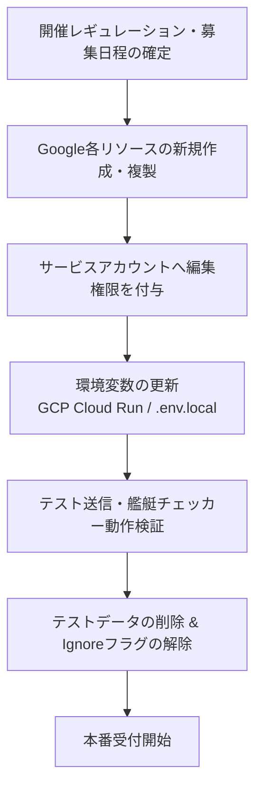

# JDM開催時 Webフォーム準備・更新手順書

本ドキュメントは、World of Warships 大会「Japan Dream Match (JDM)」の開催年度・開催回ごとに必要となる、Webフォームシステム（wows-crf）の準備および設定更新手順をまとめた運用マニュアルです。

---

## 目次

1. [全体の準備フロー](#全体の準備フロー)
2. [Googleリソースの準備](#1-googleリソースの準備)
   - [1-1. 応募登録用スプレッドシート（REGISTER_SHEET_ID）](#1-1-応募登録用スプレッドシートregister_sheet_id)
   - [1-2. API設定用スプレッドシート（API_SETTINGS_SHEET_ID）](#1-2-api設定用スプレッドシートapi_settings_sheet_id)
   - [1-3. 艦艇チェッカー・ルール用スプレッドシート（SHIP_AND_RULES_SHEET_ID）](#1-3-艦艇チェッカールール用スプレッドシートship_and_rules_sheet_id)
   - [1-4. チームロゴ保存用Cloud Storageバケット（GCS_BUCKET_NAME）](#1-4-チームロゴ保存用cloud-storageバケットgcs_bucket_name)
   - [1-5. 運営Discord案内用Googleドキュメント](#1-5-運営discord案内用googleドキュメント)
3. [サービスアカウントへの権限付与](#2-サービスアカウントへの権限付与)
4. [環境変数の更新（Cloud Run / ローカル）](#3-環境変数の更新)
5. [動作確認・リハーサル手順](#4-動作確認リハーサル手順)
6. [本番公開時のチェックリスト](#5-本番公開時のチェックリスト)
7. [トラブルシューティング](#6-トラブルシューティング)
8. [付録: スプレッドシートの構造・仕様リファレンス](#7-付録-スプレッドシートの構造仕様リファレンス)

---

## 全体の準備フロー

---

## 1. Googleリソースの準備

各開催回ごとに新しく作成、または前回のシートを複製して準備します。

### 1-1. 応募登録用スプレッドシート（`REGISTER_SHEET_ID`）
応募があったチームの情報が1チーム＝1シート（タブ）として自動生成・記録されるシートです。

1. **新規スプレッドシートを作成**
   - 名前例: `JDM_応募登録_202X`
2. **初期シート名を `@init` に変更**
   > [!IMPORTANT]
   > システムは「`@` が含まれないシートの数」を応募チーム数としてカウントします。
   > 初期シート名を `@init` にしておかないと、初期シートが1チーム分として誤認されてしまいます。
3. **URLからスプレッドシートIDをコピー**
   - URL形式: `https://docs.google.com/spreadsheets/d/【ここがID】/edit`

---

### 1-2. API設定用スプレッドシート（`API_SETTINGS_SHEET_ID`）
募集期間と最大チーム数を制御するための設定シートです。

1. **新規スプレッドシートを作成**（または前年のものを複製・更新）
   - 名前例: `JDM_API設定_202X`
2. **以下の3つのシート（タブ）を作成**:

#### ① `registerPeriod` シート
| startDate | endDate | Ignore(debug) |
|---|---|---|
| 202X-11-01T20:00:00+09:00 | 202X-11-15T23:59:59+09:00 | |

- **startDate**: 募集開始日時（ISO-8601形式: `YYYY-MM-DDTHH:mm:ss+09:00`）
- **endDate**: 募集終了日時（ISO-8601形式: `YYYY-MM-DDTHH:mm:ss+09:00`）
- **Ignore(debug)**: 
  - `YES` にすると期間外でも強制的に応募を受け付けます（動作テスト時に使用）。
  - **本番時は必ず空欄（または `NO`）にしてください。**

#### ② `maxTeamAmount` シート
| teamAmount |
|---|
| 16 |

- **teamAmount**: 募集上限チーム数（半角数字）

#### ③ `logo_directory` シート
| FolderName |
|---|
| JDM9 |

- **FolderName**: チームロゴ画像を格納する Cloud Storage 内のフォルダ名（例: `JDM9`）。未指定時は `logos` フォルダに格納されます。画像ファイル名は `チーム略名.png`（または `.jpg`）となります。

3. **URLからスプレッドシートIDをコピー**

---

### 1-3. 艦艇チェッカー・ルール用スプレッドシート（`SHIP_AND_RULES_SHEET_ID`）
> [!NOTE]
> 艦艇チェッカー（`/shipchecker`）機能を利用・導入している場合に設定します。

`/shipchecker` で使用する艦艇リストおよび編成制約ルールを定義するシートです。

1. **前年度のシートを複製**して新シートを作成
   - 名前例: `JDM_艦艇ルール_202X`
2. **各シート（タブ）の確認・更新**:
   - `country`: 国家一覧（A列）
   - 艦種別シート（`dd`, `ca-cl`, `bb`, `cv`, `sb`）:
     - 参戦可能艦艇の追加・削除、Tier、レーダー有無（`hasRadar` 列: `Default`/`Optional`/`No`）、空母/航空機有無（`hasAircraft`）、BAN指定（`isBan`）の更新
   - `rules`:
     - チーム隻数（`shipAmount`）、レーダー制限（`allRadar` / `hasRadar`）、艦種制限（`dd`, `ca-cl`, `bb`, `cv`, `sb`）、同型艦制限等のレギュレーション設定
3. **URLからスプレッドシートIDをコピー**

---

### 1-4. チームロゴ保存用Cloud Storageバケット（`GCS_BUCKET_NAME`）
チーム応募時にアップロードされたロゴ画像を格納・公開ダウンロードするためのストレージバケットです。

1. **GCPコンソールで Cloud Storage バケットを新規作成**
   - バケット名例: `jdm-team-icon`
   - ロケーション: Cloud Run と同一リージョン（例: `us-central1`）推奨
   - ストレージクラス: Standard
   - アクセス制御: **「均一（Uniform）」**
   - 公開アクセスの防止 (Public Access Prevention): **「適用しない（オフ）」**（公開アクセスのため必須）
2. **ライフサイクルルールの設定（推奨）**:
   - 不要になった過去大会の画像自動整理のため、「作成から365日経過後に削除」などのルールを設定
3. **バケット名をコピー**し、環境変数 `GCS_BUCKET_NAME` に設定します。

---

### 1-5. 運営Discord案内用Googleドキュメント
登録完了画面や注意事項に表示される「JDM 運営Discord」リンクの参照先です。

- **現在の仕様**:
  - `src/components/JdmDiscordLink.tsx` で指定されたGoogleドキュメントのテキスト内容を読み込んでリンク先としています。
- **対応方法**:
  - **方法A（コード変更なし・推奨）**: 既存のGoogleドキュメントを開き、テキストに記載されているDiscord招待URLを今年度用の最新URL（有効期限無期限）に書き換える。
  - **方法B**: 新規Googleドキュメントを作成し、リンクの公開設定を「リンクを知っている全員が閲覧可」にした上で、`src/components/JdmDiscordLink.tsx` 内の `docURL` を書き換えてデプロイする。

---

## 2. サービスアカウントおよび公開アクセス権限の付与

WebフォームがGoogle各リソースにアクセスできるように、GCPのサービスアカウントやバケットに権限を付与します。

### 2-1. サービスアカウントへの権限付与
1. サービスアカウントのメールアドレス（`GOOGLE_SERVICE_ACCOUNT_EMAIL`）を確認
   - 例: `xxxxxx@<project-id>.iam.gserviceaccount.com`
2. 以下のスプレッドシートすべてに、上記メールアドレスを **「編集者」** として共有・追加する:
   - [x] 応募登録用スプレッドシート（`REGISTER_SHEET_ID`）
   - [x] API設定用スプレッドシート（`API_SETTINGS_SHEET_ID`）
   - [x] 艦艇・ルール用スプレッドシート（`SHIP_AND_RULES_SHEET_ID`）
3. Cloud Storage バケット（`jdm-team-icon`）の「権限」タブで上記サービスアカウントにロールを付与する:
   - [x] ロール: **`ストレージ オブジェクト管理者` (`roles/storage.objectAdmin`)**（アップロードおよび失敗時のロールバック削除用）

### 2-2. チームロゴバケットの全体公開設定（誰でもDL用）
リンクを知っている人が誰でもロゴを閲覧・ダウンロードできるように設定します。
1. Cloud Storage バケット（`jdm-team-icon`）の「権限」タブを開く
2. 「アクセス権を付与」をクリック
3. **新しいプリンシパル**: `allUsers`
4. **ロール**: **`ストレージ 以前のオブジェクト読み取り` (`roles/storage.legacyObjectReader`)**
   > [!NOTE]
   > `objectViewer` はバケット一覧取得（list）を許可してしまうため、直リンクでのファイル取得のみを許可する `legacyObjectReader` を使用します。

---

## 3. 環境変数の更新

準備したリソースIDを環境変数に反映します。

### 更新が必要な環境変数一覧

| 環境変数名 | 説明 | 変更要否 |
|---|---|---|
| `REGISTER_SHEET_ID` | 応募登録スプレッドシートのID | **必須更新** |
| `API_SETTINGS_SHEET_ID` | 期間・上限チーム数設定シートのID | **必須更新**（別シートにした場合） |
| `SHIP_AND_RULES_SHEET_ID` | 艦艇チェッカールールシートのID | **必須更新**（※機能有効時） |
| `SHIPCHECKER_CACHE_TTL_SECONDS` | `/api/shipchecker` のキャッシュ有効秒数（デフォルト: `300`、`0` でキャッシュ無効） | 任意（未設定時は300秒） |
| `GCS_BUCKET_NAME` | ロゴ画像保存先Cloud Storageバケット名 | 原則維持（`jdm-team-icon`） |
| `WOWS_API_APP_ID` | Wargaming Developer Room発行のAPIキー | 原則維持（有効性確認のみ） |
| `GOOGLE_SERVICE_ACCOUNT_EMAIL` | GCPサービスアカウントのメールアドレス | 原則維持 |
| `GOOGLE_PRIVATE_KEY` | サービスアカウントの秘密鍵 | 原則維持 |
| `DRIVE_FOLDER_ID` | （旧Google DriveフォルダID） | **廃止**（設定不要） |

### 反映手順

#### 本番環境（GCP Cloud Run / Secret Manager）
1. Google Cloud Console にログイン
2. **Cloud Run** > 対象サービス（`wows-crf`）を開く
3. **「新しいリビジョンの編集とデプロイ」** を選択
4. **「コンテナ」** > **「環境変数」**（またはシークレット参照）にて、上記IDを更新
5. **「デプロイ」** を実行して反映

#### ローカル開発環境（手元で確認する場合）
1. プロジェクト直下の `.env.local` を開く
2. 各IDを新しい値に書き換えて保存
3. `npm run dev` で起動して確認

---

## 4. 動作確認・リハーサル手順

本番受付開始前に、以下の手順でテストを行います。

### ステップ1: 艦艇チェッカーの動作確認
1. ブラウザで `/shipchecker` にアクセス
2. 最新年度の艦艇、国家、ルールが正しく表示されるか確認
   > [!NOTE]
   > スプレッドシートを更新してから本番へ反映されるまで、キャッシュにより最大 `SHIPCHECKER_CACHE_TTL_SECONDS` 秒（デフォルト **300秒 / 5分**）かかります。ローカル開発環境で変更を即時確認したい場合は、`.env.local` に `SHIPCHECKER_CACHE_TTL_SECONDS=0` を設定してください。
3. 規定隻数を選択し、制限チェックが意図通り動作するかテスト
4. 必要に応じて URL クエリ指定（例: `/shipchecker?ships=Des%20Moines,Shimakaze&radar=Des%20Moines`）で初期選択・レーダーカウント・違反表示が正しく動作するか確認

### ステップ2: 募集期間外の表示確認
1. API設定シートの `registerPeriod` の `Ignore(debug)` が空欄であることを確認
2. 募集期間前の場合、`/register` にアクセスして「現在は募集期間ではありません」と表示されることを確認

### ステップ3: 応募フォームのテスト送信
1. 一時的に `registerPeriod` の `Ignore(debug)` を **`YES`** に設定
2. `/register` にアクセスし、フォームが表示されることを確認
3. テストデータを入力して送信実行:
   - チーム名、チーム略名（※`@` が使えないバリデーションも確認）
   - プレイヤーIGN（実在するIGNを入力して勝率等の自動取得を確認）
   - ロゴ画像（画像ファイルを添付）
4. 完了画面が表示され、Discordリンクが正しく開けるか確認

### ステップ4: 出力結果の確認
- [ ] 応募登録用スプレッドシートにチーム略名の新しいシート（タブ）が作成されているか
- [ ] チーム情報・プレイヤー情報・勝率が正しく書き込まれているか
- [ ] スプレッドシートの **G2セル（TeamInfoの行のLogoURL列）** に画像の公開URLが書き込まれ、**H2セルにSalt、H3セルにHash** が書き込まれているか
- [ ] そのURLをブラウザのシークレットウィンドウ等（未ログイン状態）で開き、画像が直接表示・ダウンロードできるか
- [ ] バケットルート（`https://storage.googleapis.com/jdm-team-icon/`）にアクセスした際、一覧表示が拒否されるか

---

## 5. 本番公開時のチェックリスト

テスト完了後、本番受付に向けて以下を必ず実施してください。

- [ ] **テスト用シート（タブ）の削除**:
  - 応募登録用スプレッドシートから、テスト送信で作成されたシート（タブ）を削除する。
  - 残っているとチーム数カウントに含まれてしまいます（削除しない場合はシート名を `@test` 等にして除外）。
- [ ] **テスト用画像の削除**:
  - Cloud Storage バケット（`jdm-team-icon`）の `logos/` フォルダ内にあるテスト画像を削除する。
- [ ] **`Ignore(debug)` の解除**:
  - API設定用スプレッドシートの `registerPeriod` シートにある `Ignore(debug)` を **空欄** に戻す。
- [ ] **開始日時・終了日時の再確認**:
  - 日時がJST（+09:00）で正しく設定されているか確認する。
- [ ] **上限チーム数の再確認**:
  - `maxTeamAmount` が大会要項通りの数値になっているか確認する。

---

## 6. トラブルシューティング

### Q. 「現在は募集期間ではありません」から切り替わらない
- API設定シートの日時フォーマットが `YYYY-MM-DDTHH:mm:ss+09:00`（ISO-8601形式）になっているか確認してください。
- サービスアカウントにAPI設定シートの閲覧・編集権限が付与されているか確認してください。
- テスト時は `Ignore(debug)` に `YES` を入力してください。

### Q. 「募集チームが上限に達しました」と表示される
- 応募登録シート内に `@` を含まない不要なシート（テスト時の残骸など）がないか確認してください。
- `maxTeamAmount` シートの数値が想定より小さくなっていないか確認してください。

### Q. 送信時にエラー（500）が発生する
- 応募登録用スプレッドシートへのサービスアカウント「編集者」権限、および Cloud Storage バケットへの「ストレージ オブジェクト管理者」権限があるか確認してください。
- Cloud Runのログ（Cloud Logging）を確認し、詳細なエラーメッセージを追跡してください。

### Q. 艦艇チェッカーで艦艇データが読み込めない
- `SHIP_AND_RULES_SHEET_ID` のスプレッドシート名・シート名（`country`, `dd`, `ca-cl`, `bb`, `cv`, `sb`, `rules` など半角小文字）が正しく存在しているか確認してください。

---

## 7. 付録: スプレッドシートの構造・仕様リファレンス

運営管理・集計作業の参考情報です。

### 7-1. 応募登録シート（1チームごとに自動生成されるシート）
応募完了時、チーム略名をタイトルとしたシートが作成され、以下のフォーマットで出力されます。

| Type | IGN | ID | WinRate | Contact | Comment | LogoURL | SaltAndHash |
|---|---|---|---|---|---|---|---|
| `TeamInfo` | チーム略名 | チーム名 | チーム平均勝率(%) | 連絡先（Discord等） | ひとことコメント | **チームロゴ画像URL (G2セル)** | **パスワードSalt (H2セル)** |
| `player1` | 代表者IGN | アカウントID | 勝率(%) | | | | **パスワードHash (H3セル)** |
| `player2` | 選手2 IGN | アカウントID | 勝率(%) | | | | **認証失敗回数 / `Lock` (H4セル)** |
| `player3` | 選手3 IGN | アカウントID | 勝率(%) | | | | **ロック解除時刻 (H5セル)** |
| ... | ... | ... | ... | | | | |
| `player10` | 選手10 IGN | アカウントID | 勝率(%) | | | | |

> [!NOTE]
> - `TeamInfo` の行の `LogoURL` 列（**G2セル**）には、フォームでチームロゴが添付された場合に Cloud Storage の公開ダウンロードURLが格納されます（未添付時は空欄）。
> - `SaltAndHash` 列（H列）には、出場者変更認証用の **Salt（H2セル）**、**Argon2id Hash（H3セル）**、**連続認証失敗回数または `Lock`（H4セル）**、**ロック解除時刻（H5セル）** が格納されます。ロックを手動解除する場合は **H4セルとH5セルの内容を削除** してください。
> - `player1` 〜 `player10` の行は、フォームで入力されたプレイヤー数（最大10名）に応じて順に追加されます。
> - アカウントIDおよび勝率は、Wargaming API（`WOWS_API_APP_ID`）を通じて自動取得された値が格納されます。

