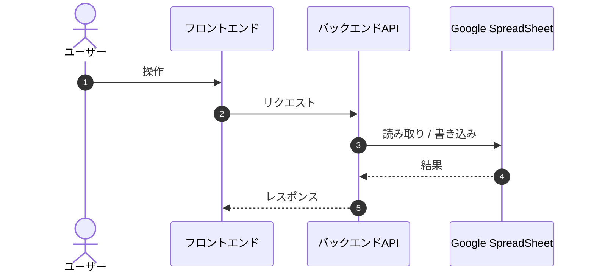

# [機能名] 設計書

| 項目 | 内容 |
|---|---|
| **ステータス** | `Draft` / `Accepted` / `Implemented` / `Superseded` |
| **作成日 / 最終更新日** | YYYY-MM-DD |
| **対象エンドポイント / 画面** | 例: `POST /api/...`, `/shipchecker` |
| **関連モジュール** | 例: `src/util/...`, `src/app/...` |

---

## 1. 概要 (Overview)

### 1.1 背景と目的
<!-- なぜこの機能・変更が必要なのか、ユーザーや運営のどのような課題を解決するのかを記述します。 -->

### 1.2 現行課題と全体方針（意思決定の根拠）
<!-- 現行コードの課題（特に Google Sheets API クォータ、レイテンシ、セキュリティ、UX 上の制約）と、それを解決するために採用したアーキテクチャ方針を記述します。却下した代替案があればその理由も明記します。 -->

---

## 2. 要件定義・インターフェース契約 (Requirements & Contracts)

### 2.1 機能要件仕様
| 項目 | 要件仕様 | 備考 / 根拠 |
|---|---|---|
| **対象機能 / API** | | |
| **入力バリデーション** | | |
| **エラー時挙動** | | |

### 2.2 API / URL / データスキーマ契約
<!-- リクエスト・レスポンスの TypeScript 型定義、URL クエリパラメータ仕様などを明記します。後方互換性（例: /api/shipchecker レスポンススキーマ（hasRadar / allRadar / ca-cl 等））の要件があれば注記します。 -->

```typescript
// 型定義イメージ
```

### 2.3 スプレッドシート / Cloud Storage 連携仕様（※該当する場合のみ）
<!-- シート名、列定義（REGISTER_HEADER 等）、セル座標（例: G2, H2〜H5）、または GCS オブジェクトパス（{FolderName}/{teamNickName}.{ext}）を正確に記述します。 -->

| 行 / セル | 列名 | 格納値 | 備考 |
|---|---|---|---|
| | | | |

---

## 3. システムアーキテクチャ・処理フロー (Architecture & Flow)



---

## 4. 詳細設計・モジュール分割 (Detailed Design)

> [!IMPORTANT]
> 単体テスト（PR 自動テスト）を高速かつ決定論的に実行できるよう、**純粋なビジネスロジック・バリデーション（`src/util/*.ts`）** と **外部 I/O・Route Handler（`src/app/api/**/route.ts`）** を分離して設計します。

### 4.1 純粋ロジック・ユーティリティ (`src/util/...`)
<!-- 関数シグネチャ、エッジケース処理、状態遷移を記述します。 -->

### 4.2 バックエンド API (`src/app/api/.../route.ts`)
<!-- バリデーション順序、外部 API 呼び出し、失敗時のロールバック処理、エラーステータスを記述します。 -->

### 4.3 フロントエンド UI (`src/app/...`)
<!-- コンポーネント構成、React Hook Form 連携、ローディング/エラー表示、Suspense 境界などを記述します。 -->

---

## 5. インフラ・セキュリティ・クォータ考慮事項 (Security & Quota)

### 5.1 Google Sheets API / 外部 API クォータ試算
| 項目 | 変更前 | 変更後 | 備考 |
|---|---|---|---|
| 1リクエストあたりの Sheets API 呼び出し回数 | | | 上限: 60 req/分/SA |

### 5.2 セキュリティ・安全性チェックリスト
- [ ] **秘密情報の保護**: コード・ログ・設計書・エラーレスポンスにスプレッドシート ID、秘密鍵、API キー、平文パスワードが含まれないこと
- [ ] **CORS 境界**: `Access-Control-Allow-Origin: *` を `/api/shipchecker` 以外の API（個人情報・登録・認証系）に付与していないこと
- [ ] **入力制限・DoS 耐性**: ペイロードサイズ上限、配列長上限、ファイル形式（マジックナンバー検証）、未認証キャッシュバイパス禁止が徹底されていること
- [ ] **XSS 防止**: 外部入力や URL パラメータを `dangerouslySetInnerHTML` 等で描画せず、React JSX テキストとして安全にエスケープしていること
- [ ] **排他制御・ロールバック**: 競合状態（Race Condition）へのロック対策、および複数ストレージ（GCS + Sheets）書き込み失敗時のロールバックがあること

---

## 6. 環境変数・ドキュメント更新計画 (Environment & Docs)

| 対象 | 更新内容 |
|---|---|
| `.env.local` / `README.md` | |
| `docs/annual-setup-guide.md` | |
| 外部連携ドキュメント (`docs/shipchecker-api/`) | |

---

## 7. テスト・検証シナリオ (Test & Verification Plan)

| ID | 区分 | 検証項目 | 入力 / 条件 | 期待結果 |
|---|---|---|---|---|
| `T-1` | Unit (`npm test`) | 正常系 | | |
| `T-2` | Unit (`npm test`) | 境界値・バリデーション拒否 | | |
| `T-3` | Unit (`npm test`) | セキュリティ・フォールバック | | |
| `T-4` | Build (`npm run build`) | 型チェック・本番ビルド | | エラーなくビルド成功 |
