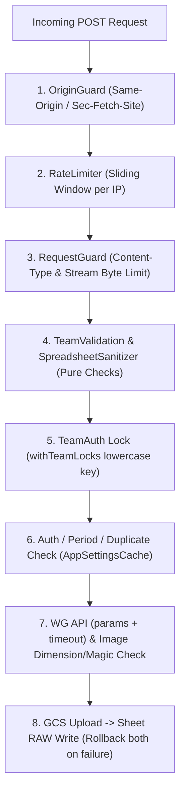

# API セキュリティ強化・入力検証・クォータ保護設計書

| 項目 | 内容 |
|---|---|
| **ステータス** | `Implemented` |
| **作成日 / 最終更新日** | 2026-11-21 |
| **対象エンドポイント / 画面** | `POST /api/register`, `POST /api/team/update`, `POST /api/team/verify`, `POST /api/ign`, `POST /api/isTeamExist`, `POST /api/isApplication`, `/register/*`, `/update/*` |
| **関連モジュール** | `src/util/SpreadsheetSanitizer.ts`, `src/util/TeamValidation.ts`, `src/util/AppSettingsCache.ts`, `src/util/RateLimiter.ts`, `src/util/RequestGuard.ts`, `src/util/OriginGuard.ts`, `src/util/UrlValidator.ts`, `src/util/SafeLogger.ts`, `src/util/ImageValidator.ts`, `src/util/StorageService.ts`, `next.config.mjs` |

---

## 1. 概要 (Overview)

### 1.1 背景と目的
本アプリケーションはパブリックリポジトリ（MIT License）として公開されており、外部へ開かれた API エンドポイントと Google SpreadSheet・Google Cloud Storage（GCS）・Wargaming API が連携して稼働します。
公開 API への直接リクエストや大量アクセスに対しても安全性を維持できるよう、以下を体系的に強化しました。

1. Google SpreadSheet への数式解釈防止および安全読み書き
2. 全フォーム送信フィールドのサーバーサイド型・形式・重複・実在検証
3. 登録・更新時の排他制御、ロールバック保証、500 エラー情報の秘匿
4. Google Sheets API クォータ保護キャッシュ・IP レート制限・Wargaming API パラメータ安全化
5. リクエストボディ上限監視、セキュリティレスポンスヘッダ、オリジン／URL 検証、画像解像度検証

### 1.2 全体方針（意思決定の根拠）
- **追加インフラ不要の多層防御**: Cloud Run 単一インスタンス運用（`--max-instances=1`）を前提に、インメモリキャッシュ（`AppSettingsCache`）・インメモリ排他ロック（`TeamAuth`）・インメモリ IP レート制限（`RateLimiter`）を組み合わせ、新規 GCP サービスを追加することなくクォータ保護と競合防止を実現します。
- **純粋ロジックの分離**: すべての検証・サニタイズ・キャッシュ・ヘッダ解析ロジックを `src/util/*.ts` の純粋関数として切り出し、外部 API を叩かずに Vitest 単体テストで決定論的に検証可能にします。
- **既存契約・互換性の維持**: `GET/OPTIONS /api/shipchecker` の CORS 公開契約、`REGISTER_HEADER`（8 列 `A..H`, `G2`, `H2..H5`）、`@` シート除外規則、`ContactInput` の `@` アカウント入力は維持します。

---

## 2. 要件定義・インターフェース契約 (Requirements & Contracts)

### 2.1 スプレッドシート安全書き込み・サニタイズ契約
| 対象 | 仕様 |
|---|---|
| **`SpreadSheetService.addRows()`** | 既定オプションを `{ raw: true }`（`valueInputOption: "RAW"`）とし、文字列を数式解釈させない |
| **`setCellStringSafe()`** | `cell.value = ...` を避け、`cell.stringValue = ...` へ明示代入して `formulaValue` 化を防止 |
| **`hasLeadingFormulaTrigger()`** | 先頭（トリム前後）の `=` および制御文字（`\t`, `\r`, `\n`, `\0`）を拒否（正当な `@handle` 等は `RAW`/`stringValue` で無害化して許可） |
| **`TeamAuth` 読出し防御** | `cell.formula` が存在するセルからは評価結果（`effectiveValue`）を返さず空文字扱いとする |

### 2.2 フォーム送信バリデーション契約 (`src/util/TeamValidation.ts`)
| フィールド | 必須 | サーバー側制約 |
|---|---|---|
| `teamName` | 必須 | 文字列型（`extractFormString`）、trim 後 1〜50 文字、先頭 `=`・制御文字不可 |
| `teamNickName` | 必須 | 文字列型、trim 後 2〜5 文字、`/^[a-zA-Z0-9_-]+$/`（`@` やパス区切り禁止）、大文字小文字非区別で重複不可 |
| `password` | 必須 | 文字列型、8〜128 文字（`MIN_PASSWORD_LENGTH`〜`MAX_PASSWORD_LENGTH`） |
| `contact` | 必須 | 文字列型、trim 後 1〜200 文字、先頭 `=`・制御文字不可 |
| `comment` | 任意 | 文字列型、trim 後 1000 文字以内、先頭 `=`・制御文字不可 |
| `player1..7` | 必須 | 3〜24 文字 `/^[a-zA-Z0-9_]+$/`、チーム内重複不可、Wargaming API 実在必須 |
| `player8..10` | 任意 | 入力時は `player1..7` と同条件（重複不可・実在必須） |
| `teamLogo` | 任意 | 最大 1 枚、20MB 以内、マジックナンバー PNG/JPEG、解像度 4096×4096px 以内 |

---

## 3. アーキテクチャ・リクエスト処理順序

---

## 4. 詳細設計・モジュール分割 (Detailed Design)

### 4.1 新設・拡充ユーティリティ (`src/util/`)
- **`SpreadsheetSanitizer.ts`**: `hasLeadingFormulaTrigger`, `validateSafeSheetText`, `assertSafeSheetCellString`, `setCellStringSafe`
- **`AppSettingsCache.ts`**: `API_SETTINGS_SHEET_ID` を 1 回の `loadInfo()`＋並列 `loadCells()` で一括取得（TTL 20 秒、Singleflight、Stale-on-Error 15 秒、コールドスタート負キャッシュ 5 秒）。`REGISTER_SHEET_ID` のタブ一覧も短期キャッシュ（TTL 10 秒）し、登録・改名時に `invalidateRegisterSheetNamesCache()` で即時破棄。
- **`RateLimiter.ts`**: バケット・クライアント IP ごとのスライディングウィンドウ制限（上限エントリ 10,000 件で自動刈り込み）。
- **`RequestGuard.ts`**: `Content-Length` 厳密パースに加え、`chunked` 転送時もストリームを読みながらバイト上限（JSON 16KB / FormData 21MB）を強制。
- **`OriginGuard.ts`**: `GET/OPTIONS /api/shipchecker` 以外のエンドポイントに対し、`Origin` / `Sec-Fetch-Site` によるクロスサイト送信を抑止（`ALLOWED_ORIGINS` 環境変数で追加許可可）。
- **`UrlValidator.ts` / `StorageService.ts`**: Discord 招待リンク（`discord.gg`, `discord.com/invite/`）と GCS 公開 URL（`https://storage.googleapis.com/{bucket}/...`）の厳格検証。
- **`SafeLogger.ts`**: エラーログ中の `application_id` 等をマスクし、500 応答では固定メッセージのみ返却。
- **`ImageValidator.ts`**: PNG `IHDR`・JPEG `SOF` ヘッダからピクセル解像度を抽出し `MAX_LOGO_DIMENSION = 4096` 以内を検証。

### 4.2 ブラウザ防御・セキュリティヘッダ (`next.config.mjs`)
全ルートに `X-Frame-Options: DENY`、`X-Content-Type-Options: nosniff`、`Referrer-Policy`、`Permissions-Policy`、`Strict-Transport-Security`、`Content-Security-Policy`（`frame-ancestors 'none'; base-uri 'self'; form-action 'self'; object-src 'none'`）を付与。`Access-Control-Allow-*` は一切設定しない。

---

## 5. インフラ・セキュリティ・クォータ考慮事項

| 項目 | 対策前 | 対策後 |
|---|---|---|
| `/api/isApplication` の Sheets Read 回数 | リクエスト毎に最大 7 回（`loadInfo` 4 回） | キャッシュヒット時 0 回、ミス時最大 2 回 `loadInfo` |
| `/api/shipchecker` の障害時挙動 | コールドスタート失敗時に連続リトライ | 5 秒コールドスタートクールダウンを追加 |
| Cloud Run インスタンス設定 | 暗黙の単一プロセス想定 | `--max-instances=1` および `GCS_BUCKET_NAME` 明示を必須運用化 |

---

## 6. テスト・検証シナリオ (Test & Verification Plan)

| ID | 対象テストファイル | 検証内容 |
|---|---|---|
| `T-1` | `tests/spreadsheet-sanitizer.test.ts` | 先頭 `=`・制御文字の拒否、`@` 許可、`setCellStringSafe`、API キーマスク |
| `T-2` | `tests/team-validation.test.ts` | 型安全抽出、`contact`/`comment`/IGN/ロスター重複、大文字小文字非区別の重複判定 |
| `T-3` | `tests/app-settings-cache.test.ts`, `tests/rate-limiter.test.ts` | TTL・Singleflight・Stale・キャッシュ無効化・スライディングウィンドウ制限 |
| `T-4` | `tests/player-lookup.test.ts` | 複数候補からの `data[i]` 正確選択、完全一致強制 |
| `T-5` | `tests/request-guard.test.ts`, `tests/origin-guard.test.ts`, `tests/storage-service.test.ts` | `chunked` サイズ超過遮断、`415` 判定、同一オリジン検証、GCS URL トラバーサル拒否 |
| `T-6` | `tests/image-validator.test.ts`, `tests/argon2-service.test.ts`, `tests/security-invariants.test.ts` | 画像解像度上限、パスワード最大長、`raw: true`・Discord URL 検証 |
| `T-7` | `npm run check && npm run build` | `security:check` + `typecheck` + `lint` + `test` + 本番ビルド成功 |
