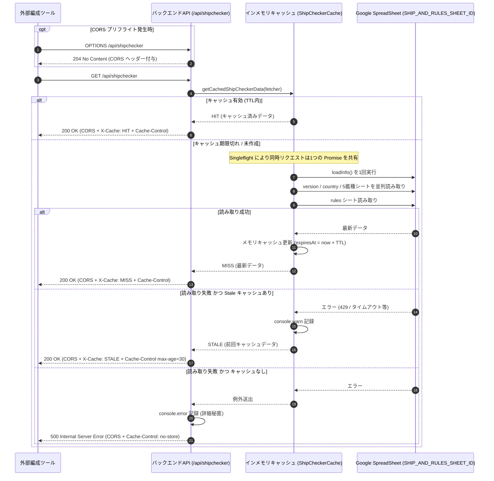
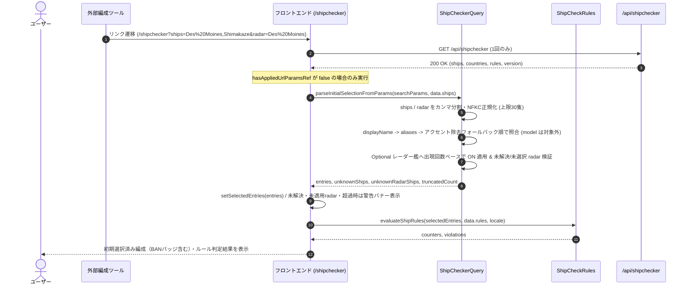
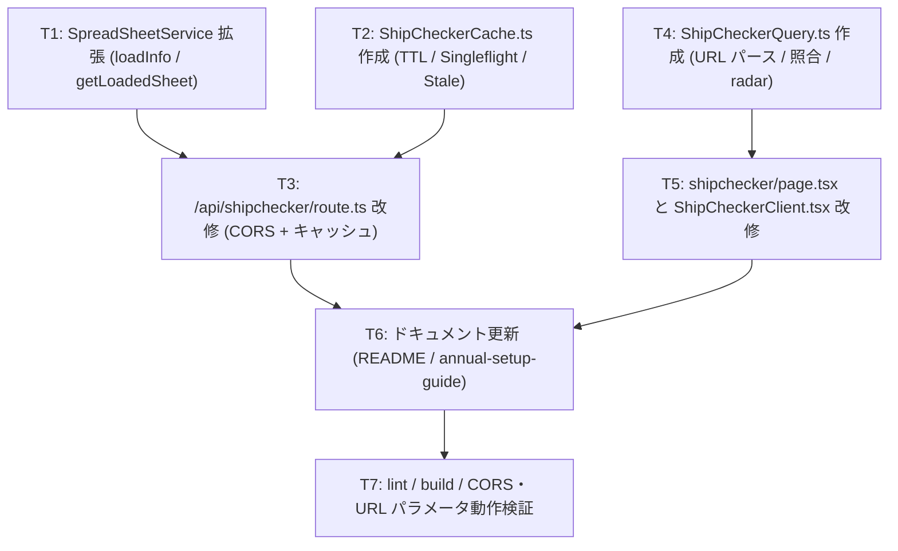

# 艦艇チェッカー外部連携機能（CORS API公開・URL初期選択）設計書

## 1. 概要 (Overview)

### 1.1 背景
外部でチーム編成検討ツールを開発しているユーザーより、艦艇チェッカー（`/shipchecker`）のルール判定を外部ツールと揃える目的で、次の2点の機能追加要望が寄せられました。

1. **(1) 外部サイトからのデータ取得許可（CORS 対応）**
   - `GET https://form.japandreammatch.info/api/shipchecker` に対し、`Access-Control-Allow-Origin: *` を付与し、ブラウザ上の外部サイトから最新の艦艇一覧およびルールデータを直接読み取れるようにする。
2. **(2) URL クエリパラメータによる艦艇・レーダー初期選択**
   - `https://form.japandreammatch.info/shipchecker?ships=Des%20Moines,Shimakaze&radar=Des%20Moines` のような URL でアクセスした際、指定された艦艇およびレーダー使用状態が選択された状態で画面を開けるようにする。

### 1.2 現行課題と全体方針
データベースが Google SpreadSheet（`SHIP_AND_RULES_SHEET_ID`）であるため、無防備に CORS を開放すると Google Sheets API の読み取りクォータ超過・パフォーマンス低下を招く懸念があります。現行コードを調査した結果、以下の構造が明らかになりました。

- **現行 API（`src/app/api/shipchecker/route.ts`）の課題**:
  - `export const dynamic = "force-dynamic"` かつキャッシュ機構が存在しないため、1アクセスのたびに Google SpreadSheet へ毎回通信が発生する。
  - `GET()` 内で `spreadSheet.getSheetNames()`（内部で `doc.loadInfo()`）を実行した後、`loadVersion()`・`loadCountryList()`・`loadRules()` が毎回 `spreadSheet.getSheet()`（内部で再び `doc.loadInfo()`）を呼んでいるため、**1リクエスト内で `doc.loadInfo()` が4回重複実行**されている。
  - これに加え、`version` / `country` / `rules` への `loadCells()`（計3回）と `SHIP_TYPES`（`dd`, `ca-cl`, `bb`, `cv`, `sb`）5シートへの `getRows()`（ヘッダー行・データ行の取得を含め最大10回）が走り、**1リクエストあたり12〜17回前後の Google Sheets API 読み取り**が発生している。
  - Google Sheets API の読み取り上限（サービスアカウントあたり 60 requests / 分、プロジェクトあたり 300 requests / 分）を考慮すると、外部サイトからの利用増加時に 429 Quota Exceeded が発生するリスクが高い。
- **URL クエリ初期選択（(2) 案）の特性**:
  - `/shipchecker` 画面（`src/app/shipchecker/components/ShipCheckerClient.tsx`）は、もともと初期表示時に `/api/shipchecker` を1回呼び出して艦艇・ルール一覧を取得する構成となっている。
  - したがって、`?ships=...&radar=...` の解析と `selectedEntries` への復元は **フロントエンドのメモリ上のみで完結**し、Google SpreadSheet への追加アクセスは一切発生しない。

以上を踏まえ、**(1) の CORS 開放とセットで `doc.loadInfo()` の1回化およびサーバー側インメモリキャッシュ（TTL・Singleflight・障害時 Stale フォールバック）を導入することで Google Sheets 負荷問題を解消し、(1) と (2) の両方を安全に実現する**方針とします。

---

## 2. 要件定義 (Requirements)

### 2.1 (1) 外部公開 API・CORS 仕様 (`/api/shipchecker`)

| 項目 | 要件仕様 | 備考 |
|---|---|---|
| **対象エンドポイント** | `GET /api/shipchecker` / `OPTIONS /api/shipchecker` | `/api/shipchecker` のみに限定 |
| **非対象エンドポイント** | `/api/register`, `/api/team/verify`, `/api/team/update`, `/api/ign`, `/api/isApplication`, `/api/isTeamExist` 等 | `next.config.mjs` でのグローバル CORS 設定は行わず、他の API には一切付与しない |
| **`Access-Control-Allow-Origin`** | `*` | 公開データ（艦艇一覧・大会ルール）かつ認証不要のため全オリジン許可 |
| **`Access-Control-Allow-Methods`** | `GET, OPTIONS` | 読み取り専用（POST/PUT/DELETE 等は不許可） |
| **`Access-Control-Allow-Headers`** | `Content-Type` | プリフライト要求への最小許可ヘッダー |
| **`Access-Control-Expose-Headers`** | `X-Cache` | 外部サイトのブラウザ JS（`fetch`）からもキャッシュ状態ヘッダーを参照可能にする |
| **`Access-Control-Max-Age`** | `86400` | プリフライト（`OPTIONS`）結果をブラウザで24時間キャッシュし不要な通信を削減 |
| **`Access-Control-Allow-Credentials`** | **付与しない** | `Allow-Origin: *` との併用不可であり、Cookie/認証情報も不要なため |
| **ヘッダー適用ステータス** | `200`（正常・stale 含む）、`204`（`OPTIONS`）、`500`（エラー）すべて | エラー時にブラウザで CORS エラーにマスクされず、適切にエラーハンドリングできるようにするため |

### 2.2 キャッシュ・Google Sheets クォータ保護仕様

| 項目 | 要件仕様 | 備考 |
|---|---|---|
| **キャッシュ方式** | Node.js プロセス内インメモリキャッシュ | `globalThis` に保持し、開発時の HMR による意図しないリセットも防止 |
| **有効期間 (TTL)** | デフォルト **300秒（5分）** | 環境変数 `SHIPCHECKER_CACHE_TTL_SECONDS` で上書き可能（非負整数。未設定・不正値は `300`）。`0` 指定時はキャッシュをバイパスし毎回取得（開発時の即時確認用） |
| **Singleflight（重複排除）** | 有効 | キャッシュ期限切れ時に複数リクエストが同時到着した場合でも、Google Sheets 読み取り `Promise` は1本のみ実行して結果を共有 |
| **Stale-on-Error（障害時保護）** | 有効 | キャッシュ期限切れ後の再取得で Google Sheets API が失敗（429・一時障害等）した場合、直前のキャッシュが存在すればそれを `200` で返却し `console.warn` を記録（初回未生成時のみ `500`）。また連続エラー時の 429 悪化を防ぐため、**30秒間の再試行クールダウン**中は `fetcher()` を呼ばず即 `STALE` 返却する |
| **HTTP `Cache-Control`** | 正常（`HIT` / `MISS`）かつ `TTL > 0`: `public, max-age={ttl}, stale-while-revalidate={ttl}`<br/>`STALE` 返却時: `public, max-age=30`<br/>`TTL === 0`（`BYPASS`）または `500` 時: `no-store` | ブラウザ・CDN キャッシュも併用しオリジンへのアクセスを抑制しつつ、Stale 返却時は早期回復を促す |
| **診断用ヘッダー** | `X-Cache: HIT \| MISS \| STALE \| BYPASS` | 動作確認・運用監視用（読み取り専用の診断情報のみ） |
| **未認証キャッシュバイパス** | **禁止** | `?refresh=1` や `Cache-Control: no-cache` での強制更新は Google Sheets クォータ枯渇（DoS）の経路となるため受け付けない |
| **Sheets 読み取り最適化** | `doc.loadInfo()` を1リクエストあたり **1回** に集約（4回 → 1回） | ロード済みブック情報から各シートを参照し、`version`・`country`・5艦種（`ships`）を並列読み込み |

### 2.3 API レスポンススキーマ契約（後方互換性）

外部ツールが依存する API レスポンスの JSON 構造は現行仕様を維持し、破壊的変更を行いません。

```typescript
// GET /api/shipchecker レスポンス型
interface ShipCheckerApiResponse {
    version: string;     // バージョン文字列（versionシート A1。未存在時は ""）
    countries: string[]; // 国家一覧
    ships: ShipData[];   // 艦艇一覧（SHIP_TYPES順、同艦種内はdisplayName昇順）
    rules: ShipRuleSet;  // ルール定義（shipAmount + rules[]）
    fetchedAt: string;   // Google SpreadSheet から取得した時刻（ISO 8601）
}
```

#### `ShipData` / `ShipRuleSet` の主要フィールド（`src/util/ShipCheckRules.ts` 準拠）
| 型 | フィールド | 型定義 | 備考 |
|---|---|---|---|
| `ShipData` | `id` | `string` | `{type}-{index}-{slug}` |
| `ShipData` | `type` | `"dd" \| "ca-cl" \| "bb" \| "cv" \| "sb"` | 艦種コード |
| `ShipData` | `rawName` | `string` | シート `name` 列の生文字列 |
| `ShipData` | `displayName` | `string` | 表示用艦名（`aliases[0]`） |
| `ShipData` | `aliases` | `string[]` | カンマ区切りの別名リスト |
| `ShipData` | `country` | `string` | 国家名 |
| `ShipData` | `tier` | `number \| null` | Tier（数値変換不可時は `null`） |
| `ShipData` | `hasRadar` | `"Default" \| "Optional" \| "No"` | レーダー搭載区分 |
| `ShipData` | `hasAircraft` | `boolean` | 航空機保有有無 |
| `ShipData` | `isBan` | `boolean` | シート BAN 指定有無 |
| `ShipData` | `addDate` | `string` | 追加日 |
| `ShipData` | `model` | `string` | 派生元モデル艦名 |
| `ShipRuleSet` | `shipAmount` | `number` | 編成隻数上限（デフォルト `7`） |
| `ShipRuleSet` | `rules` | `ShipRule[]` | `{ id, kind, targets, limit, raw }[]` |

> [!NOTE]
> - スキーマ内のプロパティ名・識別子は `hasRadar` / `allRadar` および艦種コード `dd` / `ca-cl` / `bb` / `cv` / `sb` を使用します。
> - キャッシュヒット時、レスポンス内の `fetchedAt` は「キャッシュが生成（Sheets から取得）された時刻」が返却されます。
> - `500` エラー時はスプレッドシート ID や Google API の生エラーメッセージをクライアントへ返却せず、`{ message: "Failed to load shipchecker data." }` のみを返し、詳細スタックトレースはサーバーログ（`console.error`）のみへ記録します。

---

### 2.4 (2) URL クエリ初期選択仕様 (`/shipchecker`)

| 項目 | 要件仕様 | 備考 |
|---|---|---|
| **URL 形式** | `/shipchecker?ships=<艦名1>,<艦名2>,...&radar=<艦名A>,<艦名B>,...` | 例: `/shipchecker?ships=Des%20Moines,Shimakaze&radar=Des%20Moines` |
| **パラメータ取得方法** | カンマ区切り（`?ships=A,B`）および同名パラメータ複数指定（`?ships=A&ships=B`）の両方に対応 | `searchParams.getAll("ships")` / `searchParams.getAll("radar")` を `,` で分割し前後空白トリム・空要素除去 |
| **艦名照合ルール** | NFKC 正規化・連続空白の半角スペース1つへの圧縮・小文字化による完全一致＋アクセント記号・特殊文字正規化フォールバック | 優先順位: **1. `displayName` 正規化一致 → 2. `aliases` 正規化一致 → 3. `displayName` アクセント/特殊文字除去一致 → 4. `aliases` アクセント/特殊文字除去一致**（例: `Kléber` / `Kleber`, `Gdańsk` / `Gdansk`, `Preußen` / `Preussen`, `Błyskawica` / `Blyskawica` 等の揺れを吸収）。同一優先順位で複数一致した場合は `ships` 配列の先頭を採用。**`model`（派生元のモデル艦）は別艦艇誤爆防止のため照合対象外とする** |
| **`radar` 適用ルール** | `radar` も同様に `ship.id` へ解決し、**出現回数ベース**で `hasRadar === "Optional"` の選択艦へ先頭から順に `useOptionalRadar: true` を設定 | 例: `ships=Minotaur,Minotaur&radar=Minotaur` → 1隻目のみ ON / `radar=Minotaur,Minotaur` → 2隻とも ON。選択済みの `Default` 艦や `No` 艦が `radar` に含まれていても警告せず無視する。一方、**マスター一覧に存在しない未知の艦名（typo 等）や `ships` で選択されていない艦名が `radar` に指定された場合は、`allRadar` 判定漏れを防ぐため警告バナーで通知する** |
| **BAN艦・ルール違反艦** | **そのまま選択状態に読み込む（左ペインにも「シートBAN」バッジを表示）** | 外部ツールで作成した編成の「規約違反の有無」をチェッカー画面で確認することが主目的のため、シート BAN 艦や隻数超過・ルール違反艦もスキップせず `selectedEntries` に追加し、既存の `evaluateShipRules` による違反表示で見せる。また、選択された艦のうちどれがシート BAN 艦か一目で判別できるよう、左ペインの「選択済み艦艇」カードにも `シートBAN` / `Sheet BAN` バッジを表示する |
| **未解決艦名の扱い** | スキップし、閉じる可能な警告バナーを表示（JA/EN 対応） | `ships` の未解決艦名、および `radar` の未解決・未選択艦名があっても他の有効な艦はすべて読み込み、該当した艦名のみを警告通知する（XSS 防止のため React のテキストノードで描画） |
| **読み込み上限** | `MAX_URL_SHIPS = 30` | 異常に巨大な URL による UI フリーズ防止。31件目以降は無視し、警告バナーで切り捨て件数を通知 |
| **適用タイミング** | `/api/shipchecker` 読み込み完了時に **初回1回のみ** 適用 | 言語（EN/JA）切替やユーザーによる艦の追加・削除で再適用・上書きされないよう `useRef` で管理 |
| **URL 同期（双方向）** | 行わない（受け取り専用） | ユーザーが画面上で艦を追加・削除しても URL クエリを自動書き換えはしない |

---

## 3. システムアーキテクチャ・処理フロー

### 3.1 (1) 外部サイトからの API 取得フロー (`GET /api/shipchecker`)



### 3.2 (2) URL クエリによる初期選択フロー (`/shipchecker?ships=...&radar=...`)



---

## 4. 詳細設計 (Detailed Design)

### 4.1 `GoogleSpreadsheetService` 拡張 (`src/util/SpreadSheetService.ts`)

既存の `getSheet()` や `getSheetNames()` の後方互換性は維持しつつ、`doc.loadInfo()` を明示的に1回だけ実行してキャッシュ済みワークシートを取得できるメソッドを追加します。

```typescript
// src/util/SpreadSheetService.ts への追加メソッドイメージ

/**
 * スプレッドシートのメタデータ・シート一覧を1回読み込む。
 */
async loadInfo(): Promise<void> {
    await this.doc.loadInfo();
}

/**
 * loadInfo() 済みブックから、追加の API 通信なしでワークシートを取得する。
 * @param sheetTitle シート名
 */
getLoadedSheet(sheetTitle: string): GoogleSpreadsheetWorksheet | undefined {
    return this.doc.sheetsByTitle[sheetTitle];
}
```

- 既存の `getRows(sheetTitle)` は内部で `this.doc.sheetsByTitle[sheetTitle]` のみを参照しているため、`await spreadSheet.loadInfo()` の後にそのまま並列呼び出しできます。

---

### 4.2 キャッシュユーティリティ (`src/util/ShipCheckerCache.ts` [NEW])

TTL 管理、Singleflight、Stale-on-Error、環境変数 `SHIPCHECKER_CACHE_TTL_SECONDS` のパースを担う専用モジュールを新設します。

```typescript
// src/util/ShipCheckerCache.ts
import type { ShipData, ShipRuleSet } from "@/util/ShipCheckRules";

export interface ShipCheckerPayload {
    version: string;
    countries: string[];
    ships: ShipData[];
    rules: ShipRuleSet;
    fetchedAt: string;
}

export type ShipCheckerCacheStatus = "HIT" | "MISS" | "STALE" | "BYPASS";

export interface ShipCheckerCacheResult {
    data: ShipCheckerPayload;
    cacheStatus: ShipCheckerCacheStatus;
    ttlSeconds: number;
}

interface CacheEntry {
    data: ShipCheckerPayload;
    expiresAt: number;
    staleRetryAt?: number;
}

interface InFlightResult {
    data: ShipCheckerPayload;
    cacheStatus: "MISS" | "STALE";
}

interface CacheStore {
    entry: CacheEntry | null;
    inFlight: Promise<InFlightResult> | null;
}

const DEFAULT_CACHE_TTL_SECONDS = 300;
const STALE_RETRY_COOLDOWN_MS = 30_000;
const GLOBAL_STORE_KEY = Symbol.for("wows-crf.shipchecker.cacheStore");

function getCacheStore(): CacheStore {
    const g = globalThis as typeof globalThis & { [GLOBAL_STORE_KEY]?: CacheStore };
    if (!g[GLOBAL_STORE_KEY]) {
        g[GLOBAL_STORE_KEY] = { entry: null, inFlight: null };
    }
    return g[GLOBAL_STORE_KEY];
}

export function getShipCheckerCacheTtlSeconds(): number {
    const raw = process.env.SHIPCHECKER_CACHE_TTL_SECONDS;
    if (raw === undefined || raw.trim() === "") {
        return DEFAULT_CACHE_TTL_SECONDS;
    }
    const parsed = Number(raw.trim());
    if (!Number.isFinite(parsed) || parsed < 0) {
        return DEFAULT_CACHE_TTL_SECONDS;
    }
    return Math.floor(parsed);
}

export async function getCachedShipCheckerData(
    fetcher: () => Promise<ShipCheckerPayload>,
): Promise<ShipCheckerCacheResult> {
    const ttlSeconds = getShipCheckerCacheTtlSeconds();
    if (ttlSeconds === 0) {
        const data = await fetcher();
        return { data, cacheStatus: "BYPASS", ttlSeconds };
    }

    const store = getCacheStore();
    const now = Date.now();
    if (store.entry && now < store.entry.expiresAt) {
        return {
            data: store.entry.data,
            cacheStatus: "HIT",
            ttlSeconds,
        };
    }

    if (store.entry && store.entry.staleRetryAt !== undefined && now < store.entry.staleRetryAt) {
        return {
            data: store.entry.data,
            cacheStatus: "STALE",
            ttlSeconds,
        };
    }

    if (!store.inFlight) {
        const fetchPromise: Promise<InFlightResult> = (async () => {
            try {
                const data = await fetcher();
                store.entry = {
                    data,
                    expiresAt: Date.now() + ttlSeconds * 1000,
                };
                return { data, cacheStatus: "MISS" };
            } catch (error: unknown) {
                if (store.entry) {
                    store.entry.staleRetryAt = Date.now() + STALE_RETRY_COOLDOWN_MS;
                    console.warn("Failed to refresh shipchecker cache; serving stale data.", error);
                    return { data: store.entry.data, cacheStatus: "STALE" };
                }
                throw error;
            } finally {
                if (store.inFlight === fetchPromise) {
                    store.inFlight = null;
                }
            }
        })();
        store.inFlight = fetchPromise;
    }

    const resolved = await store.inFlight;
    return {
        data: resolved.data,
        cacheStatus: resolved.cacheStatus,
        ttlSeconds,
    };
}

export function resetShipCheckerCacheForTest(): void {
    const store = getCacheStore();
    store.entry = null;
    store.inFlight = null;
}
```

---

### 4.3 バックエンド API 設計 (`src/app/api/shipchecker/route.ts`)

#### 主な変更点
1. **CORS ヘッダー定義と `OPTIONS` ハンドラ**:
   - `SHIPCHECKER_CORS_HEADERS` を共通定数とし、`createShipCheckerJsonResponse()` で `200`・`500` 両方に付与。
   - `export async function OPTIONS()` で `204 No Content` と同 CORS ヘッダーを返す。
2. **Sheets 読み取り最適化 (`fetchShipCheckerDataFromSheet`)**:
   - `await spreadSheet.loadInfo()` を先頭で **1回のみ** 実行。
   - `loadVersion`・`loadCountryList`・`loadRules` 内の `spreadSheet.getSheet(...)` を `spreadSheet.getLoadedSheet(...)` へ置換。
   - 互いに依存しない `loadVersion`・`loadCountryList`・`loadShips` を `Promise.all` で並列実行し、その後 `loadRules(spreadSheet, countries)` を実行（`loadShips` 内の `SHIP_TYPES` 5シートも `Promise.all` で並列取得し、キャッシュミス時のレイテンシを最小化）。
3. **キャッシュ連携と `Cache-Control` / `X-Cache` 設定**:
   - `GET()` は `getCachedShipCheckerData(() => fetchShipCheckerDataFromSheet(sheetId))` を経由。
   - `BYPASS`: `Cache-Control: no-store`
   - `STALE`: `Cache-Control: public, max-age=30`
   - `HIT` / `MISS`: `Cache-Control: public, max-age=${ttlSeconds}, stale-while-revalidate=${ttlSeconds}`
4. **エラー詳細の秘匿**:
   - `catch` 内では `console.error("Failed to load shipchecker data", error)` のみへ詳細を記録し、JSON 応答は `{ message: "Failed to load shipchecker data." }` とする。

#### 実装イメージ
```typescript
// src/app/api/shipchecker/route.ts (抜粋イメージ)
import { NextResponse } from "next/server";
import { GoogleSpreadsheetService } from "@/util/SpreadSheetService";
import {
    getCachedShipCheckerData,
    type ShipCheckerCacheStatus,
    type ShipCheckerPayload,
} from "@/util/ShipCheckerCache";
// ... 既存 import ...

export const dynamic = "force-dynamic";

const SHIPCHECKER_CORS_HEADERS: Record<string, string> = {
    "Access-Control-Allow-Origin": "*",
    "Access-Control-Allow-Methods": "GET, OPTIONS",
    "Access-Control-Allow-Headers": "Content-Type",
    "Access-Control-Expose-Headers": "X-Cache",
    "Access-Control-Max-Age": "86400",
};

function buildCacheControlHeader(cacheStatus: ShipCheckerCacheStatus, ttlSeconds: number): string {
    if (cacheStatus === "BYPASS" || ttlSeconds <= 0) {
        return "no-store";
    }
    if (cacheStatus === "STALE") {
        return "public, max-age=30";
    }
    return `public, max-age=${ttlSeconds}, stale-while-revalidate=${ttlSeconds}`;
}

function createShipCheckerJsonResponse(
    body: unknown,
    status: number,
    extraHeaders?: Record<string, string>,
) {
    return NextResponse.json(body, {
        status,
        headers: {
            ...SHIPCHECKER_CORS_HEADERS,
            ...extraHeaders,
        },
    });
}

async function fetchShipCheckerDataFromSheet(sheetId: string): Promise<ShipCheckerPayload> {
    const spreadSheet = new GoogleSpreadsheetService(sheetId);
    await spreadSheet.loadInfo();

    const [version, countries, ships] = await Promise.all([
        loadVersion(spreadSheet),
        loadCountryList(spreadSheet),
        loadShips(spreadSheet),
    ]);
    const rules = await loadRules(spreadSheet, countries);

    return {
        version,
        countries,
        ships,
        rules,
        fetchedAt: new Date().toISOString(),
    };
}

export async function OPTIONS() {
    return new NextResponse(null, {
        status: 204,
        headers: SHIPCHECKER_CORS_HEADERS,
    });
}

export async function GET() {
    try {
        const sheetId = process.env.SHIP_AND_RULES_SHEET_ID;
        if (!sheetId) {
            console.error("SHIP_AND_RULES_SHEET_ID is not configured.");
            return createShipCheckerJsonResponse(
                { message: "Shipchecker service is not configured." },
                500,
                { "Cache-Control": "no-store" },
            );
        }

        const result = await getCachedShipCheckerData(() => fetchShipCheckerDataFromSheet(sheetId));

        return createShipCheckerJsonResponse(result.data, 200, {
            "Cache-Control": buildCacheControlHeader(result.cacheStatus, result.ttlSeconds),
            "X-Cache": result.cacheStatus,
        });
    } catch (error: unknown) {
        console.error("Failed to load shipchecker data", error);
        return createShipCheckerJsonResponse(
            { message: "Failed to load shipchecker data." },
            500,
            { "Cache-Control": "no-store" },
        );
    }
}
```

> [!NOTE]
> `loadShips()` 内の `SHIP_TYPES` ループも `await Promise.all(SHIP_TYPES.map((type) => spreadSheet.getRows(type)))` で並列取得してから結合する方式に統一し、キャッシュミス時のレイテンシを最小化します。また、`loadVersion` / `loadCountryList` / `loadRules` では `spreadSheet.getLoadedSheet(...)` を使うことで、追加の `doc.loadInfo()` 呼び出しをゼロにします。

---

### 4.4 URL クエリ解析ユーティリティ (`src/util/ShipCheckerQuery.ts` [NEW])

URL パラメータのパース・艦名解決・レーダー適用ロジックを純粋関数として切り出し、単体検証しやすい構造にします。

> [!NOTE]
> `src/app/api/shipchecker/route.ts` にて `aliases = parseCsv(rawName)`（カンマ区切り）として艦名が分割されているため、`displayName` および `aliases` 自体にカンマが含まれることはなく、URL のカンマ区切り（`?ships=A,B`）と競合しません。

```typescript
// src/util/ShipCheckerQuery.ts
import type { SelectedShipEntry, ShipData } from "@/util/ShipCheckRules";

export const MAX_URL_SHIPS = 30;
const MAX_URL_RADAR_TOKENS = 100;

export interface SearchParamsLike {
    getAll(name: string): string[];
}

export interface ParsedShipCheckerQuery {
    entries: SelectedShipEntry[];
    unknownShips: string[];
    unknownRadarShips: string[];
    truncatedCount: number;
}

/**
 * 全角・半角の統一（NFKC）、前後空白トリム、連続空白の半角スペース1つへの圧縮、小文字化を行う。
 */
export function normalizeName(value: string): string {
    return value
        .normalize("NFKC")
        .trim()
        .replace(/\s+/g, " ")
        .toLowerCase();
}

/**
 * アクセント記号（ダイアクリティカルマーク: Kléber -> kleber, Gdańsk -> gdansk）および
 * 非分解ラテン文字（Preußen -> preussen, Błyskawica -> blyskawica 等）を正規化した文字列を返す。
 */
export function stripDiacritics(value: string): string {
    return normalizeName(value)
        .normalize("NFD")
        .replace(/[\u0300-\u036f]/g, "")
        .replace(/ß/g, "ss")
        .replace(/ł/g, "l")
        .replace(/ø/g, "o");
}

export function parseCommaSeparatedValues(rawValues: string[]): string[] {
    return rawValues
        .flatMap((value) => value.split(","))
        .map((token) => token.trim())
        .filter(Boolean);
}

/**
 * 艦名を大文字小文字・全半角・連続空白・アクセント記号の揺れを吸収して完全一致で解決する。
 * 優先順位:
 *   1. displayName 正規化一致
 *   2. aliases 正規化一致
 *   3. displayName アクセント記号除去一致
 *   4. aliases アクセント記号除去一致
 * （model は別艦艇誤爆防止のため対象外）
 */
export function resolveShipByName(queryName: string, ships: ShipData[]): ShipData | null {
    const normalized = normalizeName(queryName);
    if (!normalized) {
        return null;
    }

    const displayMatch = ships.find((ship) => normalizeName(ship.displayName) === normalized);
    if (displayMatch) {
        return displayMatch;
    }

    const aliasMatch = ships.find((ship) =>
        ship.aliases.some((alias) => normalizeName(alias) === normalized),
    );
    if (aliasMatch) {
        return aliasMatch;
    }

    const strippedQuery = stripDiacritics(queryName);
    if (!strippedQuery) {
        return null;
    }

    const strippedDisplayMatch = ships.find((ship) => stripDiacritics(ship.displayName) === strippedQuery);
    if (strippedDisplayMatch) {
        return strippedDisplayMatch;
    }

    const strippedAliasMatch = ships.find((ship) =>
        ship.aliases.some((alias) => stripDiacritics(alias) === strippedQuery),
    );
    return strippedAliasMatch ?? null;
}

export function parseInitialSelectionFromParams(
    searchParams: SearchParamsLike,
    ships: ShipData[],
): ParsedShipCheckerQuery {
    const allShipNames = parseCommaSeparatedValues(searchParams.getAll("ships"));
    const radarNames = parseCommaSeparatedValues(searchParams.getAll("radar")).slice(0, MAX_URL_RADAR_TOKENS);
    if (allShipNames.length === 0 && radarNames.length === 0) {
        return {
            entries: [],
            unknownShips: [],
            unknownRadarShips: [],
            truncatedCount: 0,
        };
    }

    const truncatedCount = Math.max(0, allShipNames.length - MAX_URL_SHIPS);
    const targetShipNames = allShipNames.slice(0, MAX_URL_SHIPS);

    const resolvedShips: { rawName: string; ship: ShipData | null }[] = targetShipNames.map((shipName) => ({
        rawName: shipName,
        ship: resolveShipByName(shipName, ships),
    }));

    const selectedShipIds = new Set<string>(
        resolvedShips.map((item) => item.ship?.id).filter((id): id is string => Boolean(id)),
    );

    const radarCountByShipId = new Map<string, number>();
    const unknownRadarShips: string[] = [];

    for (const radarName of radarNames) {
        const matchedShip = resolveShipByName(radarName, ships);
        if (!matchedShip || !selectedShipIds.has(matchedShip.id)) {
            if (!unknownRadarShips.includes(radarName)) {
                unknownRadarShips.push(radarName);
            }
            continue;
        }
        radarCountByShipId.set(matchedShip.id, (radarCountByShipId.get(matchedShip.id) ?? 0) + 1);
    }

    const entries: SelectedShipEntry[] = [];
    const unknownShips: string[] = [];

    for (const { rawName, ship: matchedShip } of resolvedShips) {
        if (!matchedShip) {
            if (!unknownShips.includes(rawName)) {
                unknownShips.push(rawName);
            }
            continue;
        }

        let useOptionalRadar = false;
        if (matchedShip.hasRadar === "Optional") {
            const remaining = radarCountByShipId.get(matchedShip.id) ?? 0;
            if (remaining > 0) {
                useOptionalRadar = true;
                radarCountByShipId.set(matchedShip.id, remaining - 1);
            }
        }

        entries.push({
            ship: matchedShip,
            useOptionalRadar,
        });
    }

    return {
        entries,
        unknownShips,
        unknownRadarShips,
        truncatedCount,
    };
}
```

---

### 4.5 ページ・フロントエンド UI 改修

#### ① `src/app/shipchecker/page.tsx` の `<Suspense>` ラップ
Next.js App Router（`next build`）では Client Component 内で `useSearchParams()` を使用する場合、親の Server Component 側で `<Suspense>` バウンダリを設ける必要があります（既存の `src/app/register/error/page.tsx` と同パターン）。

```tsx
// src/app/shipchecker/page.tsx
import { Suspense } from "react";
import ShipCheckerClient from "@/app/shipchecker/components/ShipCheckerClient";

export default function ShipCheckerPage() {
    return (
        <Suspense
            fallback={
                <main className="min-h-screen bg-slate-200 dark:bg-gray-800 px-4 py-6 text-slate-900 dark:text-slate-100 transition-colors duration-200">
                    <div className="mx-auto max-w-5xl rounded-lg border border-slate-300 dark:border-slate-700 bg-slate-50 dark:bg-slate-900/40 p-6 shadow-sm dark:shadow-none">
                        読み込み中... / Loading...
                    </div>
                </main>
            }
        >
            <ShipCheckerClient />
        </Suspense>
    );
}
```

#### ② `src/app/shipchecker/components/ShipCheckerClient.tsx` の改修
1. `useSearchParams()` からクエリパラメータを取得し、`hasAppliedUrlParamsRef = useRef(false)` を用いて、`status === "ready"` かつ `data` 取得完了後の初回1回だけ `parseInitialSelectionFromParams(searchParams, data.ships)` を実行する。
2. 解決できた艦艇があれば `setSelectedEntries(parsed.entries)` をセットする。
3. 未解決艦名（`unknownShips.length > 0`）、未解決・未選択の `radar` 指定艦名（`unknownRadarShips.length > 0`）、または上限超過（`truncatedCount > 0`）がある場合は、`urlWarning` state に保存し、ヘッダー直下へ閉じるボタン付きの警告バナーを表示する。
4. `SHIP_CHECKER_TEXT` に英語・日本語の警告文言を追加し、言語切替に追従させる。また、長い未知の文字列でレイアウトが崩れないよう `break-all` と表示文字数制限（例: 60文字で `...` 省略）を適用し、必ず React の JSX テキストとしてレンダリングする（`dangerouslySetInnerHTML` 等は使用しない）。
5. **左ペイン「選択済み艦艇」カードへの `シートBAN` バッジ追加**:
   - 現行の `ShipCheckerClient.tsx` では右ペイン（候補一覧）のみに `ship.isBan` バッジがあり、左ペイン（選択済み艦艇）には表示されていない。URL クエリでシート BAN 艦が読み込まれた際、どの選択艦がシート BAN 違反の原因か一目で分かるよう、左ペインのバッジ列にも `entry.ship.isBan` バッジ（`{text.sheetBanLabel}`）を追加する。

```typescript
// ShipCheckerText 追加フィールドイメージ
urlWarningTitle: string;
urlUnknownShips: (names: string) => string;
urlUnknownRadarShips: (names: string) => string;
urlTruncatedShips: (limit: number, omitted: number) => string;
dismissWarning: string;
```

```tsx
// ShipCheckerClient.tsx 内の適用フック・警告バナーイメージ
const searchParams = useSearchParams();
const hasAppliedUrlParamsRef = useRef(false);
const [urlWarning, setUrlWarning] = useState<{
    unknownShips: string[];
    unknownRadarShips: string[];
    truncatedCount: number;
} | null>(null);

useEffect(() => {
    if (status !== "ready" || !data || hasAppliedUrlParamsRef.current) {
        return;
    }
    hasAppliedUrlParamsRef.current = true;

    const parsed = parseInitialSelectionFromParams(searchParams, data.ships);
    if (parsed.entries.length > 0) {
        setSelectedEntries(parsed.entries);
    }
    if (
        parsed.unknownShips.length > 0 ||
        parsed.unknownRadarShips.length > 0 ||
        parsed.truncatedCount > 0
    ) {
        setUrlWarning({
            unknownShips: parsed.unknownShips,
            unknownRadarShips: parsed.unknownRadarShips,
            truncatedCount: parsed.truncatedCount,
        });
    }
}, [data, searchParams, status]);
```

```tsx
// 左ペイン「選択済み艦艇」カード内のバッジ列へのシートBANバッジ追加イメージ
{entry.ship.hasAircraft && (
    <span className="rounded bg-indigo-600 text-white dark:bg-indigo-700/70 px-2 py-0.5 dark:text-indigo-100">
        {text.aircraftLabel}
    </span>
)}
{entry.ship.isBan && (
    <span className="rounded bg-rose-600 text-white dark:bg-rose-700/70 px-2 py-0.5 dark:text-rose-100">
        {text.sheetBanLabel}
    </span>
)}
```

警告バナーのスタイルは既存ページ（`src/app/update/success/page.tsx`）と調和する `border-amber-400 dark:border-amber-600 bg-amber-50 dark:bg-amber-950/40 text-amber-900 dark:text-amber-100` を使用し、ライト/ダーク両テーマに対応させます。

---

## 5. インフラ・セキュリティ・運用考慮事項

### 5.1 Cloud Run キャッシュ特性と Google Sheets API クォータ試算

| 項目 | 改修前（現行） | 改修後（本設計） |
|---|---|---|
| `doc.loadInfo()` 回数 / 取得 | 4回 | **1回** |
| 合計 Sheets API 読み取り / 取得 | 約 12〜17 回 | **約 9〜14 回**（`loadInfo` 1 + `loadCells` 3 + `getRows` 5〜10） |
| 100ユーザー連続アクセス時の API 呼び出し | 1,200〜1,700 回（**即 60 req/分 超過**） | **1回分のみ**（5分間で約 9〜14 回 ≒ **約 1.8〜2.8 req/分**） |
| 同時リクエスト集中時 | 並列数分だけ Sheets へ直撃 | Singleflight により **1回のみ** 実行 |

- Cloud Run のデフォルト最大同時リクエスト数は1コンテナあたり80件であるため、通常の大会アクセス規模では単一または少数のコンテナに集約され、インメモリキャッシュのみで極めて高い負荷削減効果が得られます。
- オートスケールで複数コンテナが起動した場合はコンテナごとに独立したキャッシュを持ちますが、各コンテナが5分に1回しか Sheets を読まないため、クォータ余裕は十分に保たれます。また、アイドル後にコールドスタートした際は自動的に最新データが読み込まれます。

### 5.2 セキュリティチェックリスト
- [x] **CORS 適用範囲限定**: `Access-Control-Allow-Origin: *` は `/api/shipchecker` の `GET` / `OPTIONS` のみに付与し、`next.config.mjs` へのグローバル設定や個人情報・認証を扱う API（`/api/register`, `/api/team/*` 等）への付与は行わない。
- [x] **Credential 非許可**: `Access-Control-Allow-Credentials` は返却しない。
- [x] **キャッシュバイパス防止**: 未認証クライアントからサーバー側キャッシュを強制破棄するクエリパラメータやヘッダー解釈を実装しない。
- [x] **エラー詳細の非露出**: `500` 応答に `SHIP_AND_RULES_SHEET_ID` や Google API の内部例外メッセージを載せず、`console.error` のみへ記録する。
- [x] **XSS / DoS 耐性（URL クエリ）**: `ships` の展開上限を `MAX_URL_SHIPS = 30` に制限し、未知の艦名は必ず React JSX テキストとしてエスケープ描画する。

### 5.3 運用上の注意点
- **スプレッドシート更新の反映遅延**: 運営が `SHIP_AND_RULES_SHEET_ID` の艦艇一覧やルールを編集した場合、本番環境への反映には最大で `SHIPCHECKER_CACHE_TTL_SECONDS`（デフォルト **5分**）のタイムラグが生じます（ブラウザ側 `Cache-Control: max-age=300` と合わせて、最大5〜10分程度古い状態が残る場合があります）。
- **開発・テスト時の即時反映**: ローカル検証でシート変更をすぐ確認したい場合は、`.env.local` に `SHIPCHECKER_CACHE_TTL_SECONDS=0` を設定することでキャッシュを無効化（`X-Cache: BYPASS`）できます。

---

## 6. 環境変数・ドキュメント更新計画

### 6.1 環境変数の追加

| 環境変数名 | 必須/任意 | デフォルト値 | 説明 |
|---|---|---|---|
| `SHIPCHECKER_CACHE_TTL_SECONDS` | 任意 | `300` | `/api/shipchecker` のインメモリキャッシュおよび HTTP `max-age` の有効秒数。`0` でキャッシュ無効化 |
| `SHIP_AND_RULES_SHEET_ID` | 既存維持 | - | 艦艇・ルール定義用 Google SpreadSheet ID |

### 6.2 `README.md`・`docs/annual-setup-guide.md` の追記内容（実装フェーズで更新）
- `README.md`: `.env.local` の記述例に任意の環境変数 `SHIPCHECKER_CACHE_TTL_SECONDS`（必要な場合のみ設定）の補足を追加。
- `docs/annual-setup-guide.md`: 「4. 動作確認・リハーサル手順（ステップ1: 艦艇チェッカーの動作確認）」へ、スプレッドシート更新後にキャッシュ反映まで最大5分かかる旨と、URL クエリ付き動作確認例を追記。

### 6.3 外部ツール開発者向け 共有用仕様サマリー

要望元の開発者へ回答・案内する際は、以下の仕様をそのまま共有できます。

1. **API エンドポイント（CORS 対応）**
   - URL: `GET https://form.japandreammatch.info/api/shipchecker`
   - `Access-Control-Allow-Origin: *`（および `Access-Control-Expose-Headers: X-Cache`）を返却します（ブラウザから直接 `fetch` 可能）。
   - サーバーおよびブラウザで **最大5分（300秒）のキャッシュ** が効くため、スプレッドシート更新直後は数分間旧データが返る場合があります。
   - **フィールド名・識別子**: JSON 内のプロパティ名 `hasRadar`、特殊ルール `allRadar`、および巡洋艦コード `ca-cl` を使用します。
2. **URL クエリ連携**
   - URL 形式: `https://form.japandreammatch.info/shipchecker?ships=<艦名1>,<艦名2>&radar=<艦名1>`
   - カンマ区切り（URL エンコード必須。例: `Des%20Moines`）で複数指定でき、大文字・小文字・全半角・連続スペース・アクセント記号や特殊文字の表記揺れ（例: `Kléber` / `Kleber`, `Preußen` / `Preussen`, `Błyskawica` / `Blyskawica`）を問わず表示名（`displayName`）または別名（`aliases`）で一致させます（`model` 欄では一致させません）。
   - `radar` は `hasRadar === "Optional"` の艦に対して、登場回数ベースで先頭の該当艦から順にレーダー使用 ON にします（例: 同型艦2隻のうち1隻だけレーダー使用なら `radar=艦名` を1回だけ指定）。
   - シート上で BAN されている艦やルール違反の組み合わせも比較確認のためそのまま読み込まれ、選択済み艦カードの「シートBAN」バッジおよび画面下のルールチェック欄に違反が表示されます。
   - `ships` や `radar` に存在しない艦名（または `ships` に含まれない `radar` 指定艦）がある場合はスキップして画面上部に警告を表示します。1度に読み込める上限は30隻です。

---

## 7. 実装計画・タスク一覧 (Task List)



### ステップ別作業内容

1. **T1 (`src/util/SpreadSheetService.ts`)**: `loadInfo()` と `getLoadedSheet()` を追加。
2. **T2 (`src/util/ShipCheckerCache.ts`)**: TTL・Singleflight・Stale-on-Error・`SHIPCHECKER_CACHE_TTL_SECONDS` 解釈を実装。
3. **T3 (`src/app/api/shipchecker/route.ts`)**: `OPTIONS` ハンドラ、CORS 共通ヘッダー（`Access-Control-Expose-Headers: X-Cache` 含む）、`loadInfo()` 1回化＋5艦種シートを含む `Promise.all` 並列読み取り、キャッシュ連携、`Cache-Control` / `X-Cache` 設定、500 エラー詳細秘匿を実装。
4. **T4 (`src/util/ShipCheckerQuery.ts`)**: `normalizeName`（NFKC・連続空白圧縮）、`stripDiacritics`（アクセント記号除去フォールバック）、`parseCommaSeparatedValues`、`resolveShipByName`、`parseInitialSelectionFromParams`（`unknownShips` / `unknownRadarShips` 検出含む）を実装。
5. **T5 (`src/app/shipchecker/page.tsx`, `src/app/shipchecker/components/ShipCheckerClient.tsx`)**: `<Suspense>` ラップ、`useSearchParams()` と `hasAppliedUrlParamsRef` による初期選択復元、左ペイン「選択済み艦艇」カードへの `シートBAN`（`entry.ship.isBan`）バッジ追加、警告バナー（JA/EN・ライト/ダーク対応）を実装。
6. **T6 (`README.md`, `docs/annual-setup-guide.md`)**: 新環境変数・キャッシュ挙動の運用注記を追記。
7. **T7 (動作検証)**:
   - **静的チェック**: `npm run lint` および `npm run build`（`useSearchParams()` の Suspense ビルドエラーが出ないことを確認）。
   - **API / CORS / キャッシュ確認**:
     - `curl -i -X OPTIONS http://localhost:3000/api/shipchecker` → `204`、全 CORS ヘッダー確認。
     - `curl -i http://localhost:3000/api/shipchecker` → 1回目 `X-Cache: MISS`、2回目以降（TTL 内）`X-Cache: HIT`、`Cache-Control: public, max-age=300, stale-while-revalidate=300`、`Access-Control-Allow-Origin: *`、`Access-Control-Expose-Headers: X-Cache` を確認。
     - 他の API（例: `/api/isApplication` 等）に `Access-Control-Allow-Origin` が付与されていないことを確認。
     - 別オリジンのブラウザ DevTools コンソールから `fetch("http://localhost:3000/api/shipchecker").then(r => r.json())` が CORS エラーなく成功することを確認。
     - `SHIP_AND_RULES_SHEET_ID` を不正値にした状態で、キャッシュ有なら `X-Cache: STALE` で `200`、キャッシュ無なら `500`（汎用メッセージ＋CORS ヘッダー付き）となることを確認。
   - **URL クエリ確認**:
     - `?ships=Des%20Moines,Shimakaze&radar=Des%20Moines` で対象艦が選択されること。
     - 別名（`aliases`）・大文字小文字混在（`des moines`, `SHIMAKAZE`）・全角/連続空白・アクセント記号や非分解ラテン文字の表記揺れ（例: `Kléber` / `Kleber`, `Preußen` / `Preussen`, `Błyskawica` / `Blyskawica`）で一致し、`model` のみの文字列では誤爆しないこと。
     - 同一 `Optional` 艦2隻＋`radar` 1回指定で、1隻目のみ `useOptionalRadar` が ON になること（2回指定なら両方 ON）。
     - 選択済みの `Default` / `No` 艦を `radar` に含めても警告やエラーにならず無視され、未知の艦名または `ships` 未選択の艦名を `radar` に指定した場合（`ships` 未指定で `?radar=Des%20Moines` のみ指定した場合を含む）は警告バナーが出ること。
     - シート BAN 艦やルール違反艦も選択され、左ペインの選択済み艦カードに「シートBAN」バッジが表示されるとともに下部ルールチェック欄に違反表示が出ること。
     - 存在しない艦名指定時に有効艦のみ追加され、警告バナー（JA/EN 切替追従・閉じるボタン動作）が出ること。
     - 31隻以上指定時に30隻で切り捨てられ、警告バナーが出ること。
     - クエリなし（`/shipchecker`）および空値（`?ships=&radar=`）で従来通り空選択・警告なしで動作すること。

---

## 8. 確認事項・検討事項 (Open Questions)

1. **「現在の編成 URL をコピー」ボタンの追加（将来の拡張候補）**
   - 本設計では外部ツールからの URL 受け取り（インバウンド）を対象としましたが、艦艇チェッカー上で組んだ編成を `?ships=...&radar=...` 形式でクリップボードへコピーするボタンがあると、プレイヤー間の編成共有にも役立ちます。要望があれば Phase 2 として追加可能です。
2. **アクセス規模がさらに拡大した場合の静的 JSON 配信**
   - 現状のアクセス規模では 5分 TTL インメモリキャッシュで Google Sheets API クォータを十分保護できますが、もし将来 Cloud Run コンテナが常時多数スケールアウトする規模になった場合は、シート更新時または定期バッチで Cloud Storage（`jdm-team-icon` 等）へ JSON を書き出して CDN 経由で配信する方式へ拡張可能です。
3. **運営による即時キャッシュクリア手段**
   - 大会直前にルールシートを緊急修正した際、5分の TTL 経過を待たずに即座に反映したい運用ニーズが生じる場合は、認証トークン付きの管理用パージ機構（または Cloud Run リビジョンの再デプロイによるプロセス再起動）を検討します。
