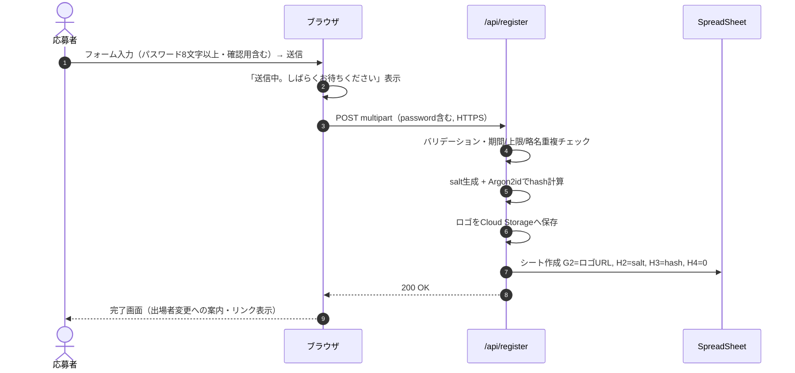
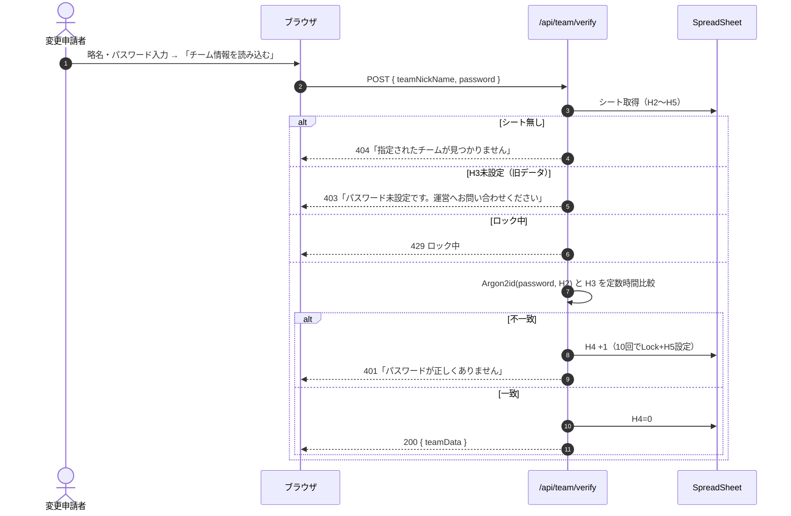
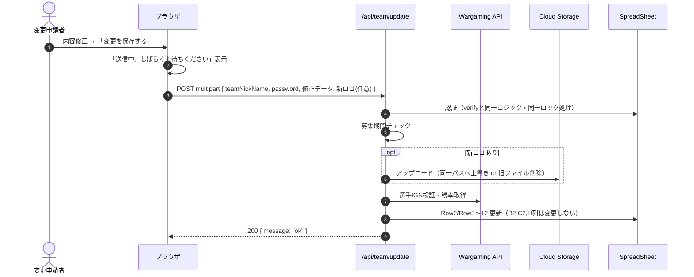

# 出場者変更機能およびArgon2パスワード認証 実装計画・設計書（改訂版）

## 1. 概要 (Overview)

### 1.1 背景と目的
Japan Dream Match (JDM) のエントリー受付において、応募完了後にチームメンバーや連絡先、コメント、チームロゴを変更したいという要望が発生します。従来は運営Discordでの手動受付・スプレッドシートの手作業修正を行っていましたが、応募者自身がWebフォームから登録内容を変更できる「**出場者変更機能**」を新規追加します。

第三者による改ざん防止のため、新規応募時にパスワードを設定し、変更時に「チーム略名」と「パスワード」で認証します（知識認証のみ）。

### 1.2 セキュリティ方針（決定事項）
- サイトは **HTTPS 前提**。パスワードは HTTPS 上で API に送信してよい（通信経路の追加対策は行わない）。
- **ソルト生成とArgon2ハッシュ化はすべてバックエンドAPI側で行う。** ブラウザはハッシュ計算をしない。
- 保存するのはソルトとハッシュのみ（平文は保存・ログ出力しない）。
- **チーム略名はセキュリティ要素として扱わない**（参加チームは追って公開されるため、存在判別は許容）。認証はパスワードのみに依存する。
- パスワードは **8文字以上**。
- **総当たり対策**: 連続10回認証に失敗すると一時ロック。成功のたびに失敗回数を0に戻す。
- クライアントが送るハッシュを検証する方式（pass-the-hash問題）は、ハッシュをクライアントで扱わなくなるため解消される。

---

## 2. 要件定義 (Requirements)

| No | 機能項目 | 要件詳細 | 備考 |
|---|---|---|---|
| 1 | **トップページ導線追加** | トップページ（`/`）に「出場者の変更」ボタンを追加し、`/update` へ遷移させる。 | Chakra UI |
| 2 | **出場者変更機能** | チーム略名とパスワードで認証し、登録済みスプレッドシートを書き換える。**チーム名・チーム略名は変更不可。** | 連絡先、コメント、選手1〜10、ロゴを変更可 |
| 3 | **Spreadsheetセル配置変更** | G1 `LogoURL` / G2 ロゴURL（旧F3）<br/>H1 `SaltAndHash` / H2 Salt / H3 Hash / **H4 失敗回数 or `Lock`** / **H5 ロック解除時刻** | ヘッダーは8列 |
| 4 | **応募フォームの注意書き** | チーム名・略名の入力欄に赤字で「チーム名は送信後変更ができません」「チーム略名は送信後変更ができません」 | |
| 5 | **送信中表示** | 送信ボタン押下後、ボタン下に「送信中。しばらくお待ちください」 | 応募・変更フォーム両方 |
| 6 | **登録完了画面の案内追加** | 応募完了画面（`/register/success`）に「チーム変更はこちらからお願いします」の案内と `/update` へのボタン・リンクを配置 | |
| 7 | **パスワードのArgon2ハッシュ化** | API側でランダムソルト生成 → Argon2idでハッシュ化し H2/H3 に保存 | `hash-wasm`（Node実行） |
| 8 | **ブルートフォース対策** | 連続10回失敗で一時ロック。成功で回数リセット | H4/H5 |
| 9 | **ハッシュ生成ツール** | `/generatehash`（リンク直打ちで誰でも閲覧可）。ソルトとパスワードを入力するとハッシュを表示 | 運営確認用 |

---

## 3. 認証アーキテクチャ

### 3.1 Argon2 パラメータ（API・管理ツール共通）
共通モジュール `src/util/Argon2Service.ts` に集約し、API と `/generatehash` の双方が同一処理を使用する。

| パラメータ | 設定値 |
|---|---|
| アルゴリズム | Argon2id |
| ソルト | 16 bytes（`crypto.randomBytes(16)`）。**32文字のhex文字列としてH2に保存。ハッシュ計算時はhexをバイト列にデコードして使用**（API・generatehashで同一処理） |
| iterations | 2 |
| memorySize | 19,456 KiB |
| parallelism | 1 |
| hashLength | 32 bytes → 64文字hex（H3） |

> [!NOTE]
> `/generatehash` はブラウザ内で `hash-wasm` を実行する（パスワードはどこにも送信しない）。ソルトhexのデコード規則をAPIと揃えることで、H3と一致する値を得られる。

### 3.2 ロックポリシー
- 対象: `/api/team/verify` と `/api/team/update` の認証処理（両方で失敗をカウント）。
- 失敗時: H4 を +1。**10回に達したら H4 に `Lock` を記入し、H5 にロック解除時刻（ISO 8601、現在時刻+1時間）を記入**。
- ロック中: 正しいパスワードでも認証せず `429`（「ロック中です。しばらくしてから再度お試しください」）。ハッシュ計算もスキップ。
- 解除: H5 の時刻を過ぎていれば次回アクセス時に自動解除（H4=0、H5クリア）して通常認証。
- 成功時: H4 を 0 に戻す（H5もクリア）。
- 運営による手動解除: **H4 と H5 のセルの内容を削除する**。H4 が空（またはH4/H5が未設定）の場合は「失敗回数0・ロックなし」として扱う（空セルを例外にしない）。
- ロック時間 1時間・回数 10回は定数として `src/util/` に定義。
- **同時リクエスト対策（インメモリ排他制御）**:
  - Next.js（Node.js ランタイム / Cloud Run）のサーバープロセス内で、認証処理中の `teamNickName` を `Set<string>`（または `Map<string, Promise>`）で管理する。
  - 同一チームに対して認証処理が実行中の間に別リクエストが来た場合は、即座に `429`（「現在処理中です。しばらく待ってから再度お試しください」）を返すか直列 대기させることで、並列リクエストによる失敗回数カウントのすり抜け（Race Condition）を防止する。

> [!NOTE]
> 「一時的にロック」を実現するため、H4 に加えて **H5（ロック解除時刻）** を使用します。

### 3.3 処理シーケンス

#### (1) 新規登録 (`/register`)


#### (2) 認証・データ取得 (`/update`)


#### (3) 更新 (`/update`)

> 認証はステートレス（トークン発行なし）。`verify` と `update` の双方でパスワードを送り、都度検証する。そのためフォームはパスワードを画面状態に保持する。

---

## 4. スプレッドシート詳細設計

| 行 | A (Type) | B (IGN) | C (ID) | D (WinRate) | E (Contact) | F (Comment) | G (LogoURL) | H (SaltAndHash) |
|:---:|---|---|---|---|---|---|---|---|
| 1 | `Type` | `IGN` | `ID` | `WinRate` | `Contact` | `Comment` | `LogoURL` | `SaltAndHash` |
| 2 | `TeamInfo` | チーム略名 | チーム名 | 平均勝率 | 連絡先 | コメント | **ロゴURL** | **Salt** |
| 3 | `player1` | IGN | ID | 勝率 | | | | **Hash** |
| 4 | `player2` | IGN | ID | 勝率 | | | | **失敗回数 / `Lock`** |
| 5 | `player3` | IGN | ID | 勝率 | | | | **ロック解除時刻** |
| 6〜12 | `player4`〜`player10` | | | | | | | |

変更点:
1. `src/util/SheetHeader.ts` の `REGISTER_HEADER` を `["Type","IGN","ID","WinRate","Contact","Comment","LogoURL","SaltAndHash"]` の8列へ。
2. ロゴURL: 旧 F3 → **G2**。F3は空欄。
3. H2=Salt(32hex) / H3=Hash(64hex) / H4=失敗回数 or `Lock` / H5=ロック解除時刻。
4. **F3・ヘッダー列数に依存している既存コードの洗い出しと修正**（チーム一覧・出場者表示・API設定読み出し等）。実装前に `grep` で影響箇所を特定し、H列を選手データとして誤読しないようにする。

---

## 5. バックエンド API 設計

| メソッド | パス | 役割 | 入力 |
|---|---|---|---|
| `POST` | `/api/register` | 新規登録（改修） | 既存項目 + `password` |
| `POST` | `/api/team/verify` | 認証 & 現在データ取得 | `{ teamNickName, password }` |
| `POST` | `/api/team/update` | 更新 | FormData: `teamNickName`, `password`, `contact`, `comment`, `player1〜10`, `teamLogo?` |

※ 旧設計の `/api/team/salt` は **廃止**（クライアントがソルトを必要としないため）。

### (1) `/api/register`
- `password` を 8文字以上でバリデーション（クライアント・サーバー両方）。
- salt生成・Argon2idハッシュ化はAPI内で実施し、パスワードはログに出さない。
- 書き込み: TeamInfo行 `LogoURL=uploaded.url`(G2), `SaltAndHash=salt`(H2) / player1行 `SaltAndHash=hash`(H3) / player2行 `SaltAndHash=0`(H4)。F3は空欄。

### (2) `/api/team/verify`
- 共通関数 `authenticateTeam(teamNickName, password)`（`src/util/TeamAuth.ts`）を実装し、verify と update で共用。
- ステータス: 404 チーム無し / 403 パスワード未設定（H3空） / 429 ロック中 / 401 不一致 / 200 成功。
- 成功時レスポンス: `teamName`(C2), `teamNickName`(B2), `contact`(E2), `comment`(F2), `logoUrl`(G2), `players`(B3〜B12)。
- **レスポンスにsalt/hashを含めない。**

### (3) `/api/team/update`
1. `authenticateTeam` で再認証（失敗時は同じロック処理）。
2. 募集期間チェック（`CheckTime()` / `IsIgnore()`）。期間外は拒否。
3. B2・C2・H列は一切上書きしない。
4. ロゴ更新: `ImageValidator` で検証 → 新ロゴあり: Cloud Storageへアップロード、G2更新。なし: 既存維持。
   - 拡張子が変わる場合は旧オブジェクトを削除。公開URLには `?v=タイムスタンプ` を付与してキャッシュ回避。
5. Wargaming APIで選手のUID・勝率を取得し、チーム平均勝率を再計算。
6. シート更新: D2,E2,F2,G2 / player1〜10行のB,C,D（減った分はクリア）。
7. 失敗ロールバック: シート更新に失敗した場合、新規アップロードしたロゴを削除（新規登録APIの方式に合わせる）。

---

## 6. フロントエンド設計

### 6.1 `src/util/Argon2Service.ts`
```typescript
import { argon2id } from "hash-wasm";
import { randomBytes } from "crypto"; // サーバー側のみ

export const ARGON2_CONFIG = { parallelism: 1, iterations: 2, memorySize: 19456, hashLength: 32 };

export function hexToBytes(hex: string): Uint8Array { /* 32文字hex → 16bytes */ }

export async function hashPassword(password: string, saltHex: string): Promise<string> {
    return argon2id({
        password,
        salt: hexToBytes(saltHex),
        ...ARGON2_CONFIG,
        outputType: "hex",
    });
}
// generateSalt() は API 側専用（crypto.randomBytes(16).toString("hex")）
```
`/generatehash` はクライアント側で `hashPassword` を使うため、`crypto` import を分離（`generateSalt` はサーバー専用ファイルに置く）。

### 6.2 トップページ (`src/app/page.tsx`)
登録フォームボタンの下に「出場者の変更」ボタン（遷移先 `/update`）を追加。

### 6.3 応募フォーム & 完了画面 (`/register`)
- `TeamNameInput.tsx`: 赤字「※チーム名は送信後変更ができません」。
- `TeamNickNameInput.tsx`: 赤字「※チーム略名は送信後変更ができません」。
- `PasswordInput.tsx` を追加: 必須・**8文字以上**・確認用フィールド一致チェック・表示切替・注記「※出場メンバー等の変更時に必要となります。忘れないよう必ず控えてください。」
- 送信ボタン下: `送信中。しばらくお待ちください`（`isSubmitting` 中のみ）。
- `useRegisterForm.tsx`: `password` をFormDataに追加して送信（クライアントでのハッシュ化なし）。確認用パスワードは送信しない。
- **登録完了画面 (`src/app/register/success/page.tsx`)**:
  - 「送信に成功しました」のメッセージに加え、**「チーム変更はこちらからお願いします」** という案内文と、出場者変更画面（`/update`）へのボタン・リンクを追加。
  - 「トップページに戻る」ボタンと並べて配置。

### 6.4 出場者変更ページ (`/update`)
- Phase 1（認証）: チーム略名・パスワード →「チーム情報を読み込む」。401/403/404/429 のメッセージを赤字表示。
- Phase 2（編集）: チーム名・略名は Disabled。ロゴプレビュー＋変更（任意）、連絡先、コメント、出場者1〜10（1〜7必須、8〜10任意）。「変更を保存する」ボタン下に「送信中。しばらくお待ちください」。
- 保存成功後に完了表示（`/update/success` またはインライン）。

### 6.5 `/generatehash`（`src/app/generatehash/page.tsx`）
- 認証なし・URL直打ちで閲覧可。`noindex`（`metadata.robots`）を設定。
- 入力: パスワード、ソルト（32文字hex。「ランダムソルト生成」ボタン付き）。
- 出力: Argon2idハッシュ（64文字hex、コピーボタン）。
- 計算はブラウザ内のみ（フォーム送信・URLクエリ・API通信なし）。
- 使用アルゴリズムとパラメータ、ソルトhexのデコード規則を注記。
- 既存の不要ファイル（`src/app/generatehash.tsx`、空の `src/app/generatehash/generatehash.tsx`）は整理。

---

## 7. 実装計画

1. **共通サービス & generatehash**: `Argon2Service.ts`、`/generatehash`。
2. **シート定義 & 影響調査**: `SheetHeader.ts` 拡張、F3/列数依存箇所の洗い出しと修正、`SpreadSheetService` に行・セル更新機能を追加。
3. **応募フォーム改修 & `/api/register` 更新**: 注意書き、`PasswordInput`、送信中表示、登録完了画面への案内・リンク追加、API側ハッシュ化とシート書き込み（G2/H2/H3/H4）。
4. **認証・更新API**: `TeamAuth.ts`（ロック処理含む）、`/api/team/verify`、`/api/team/update`。
5. **変更UI & トップ導線**: `/update`、トップのボタン、送信中表示。
6. **結合テスト & ドキュメント更新**（README、`docs/annual-setup-guide.md` のシート仕様）。
   - 追加ライブラリ: `hash-wasm`（README導入ライブラリ欄に追記）。

---

## 8. テスト・検証シナリオ

| No | 項目 | 期待結果 |
|---|---|---|
| T-1 | 新規登録のシート確認 | G1=`LogoURL`, G2=URL / H1=`SaltAndHash`, H2=32hex, H3=64hex, H4=0 / F3は空 |
| T-2 | パスワード保存確認 | シート・ログのどこにも平文が存在しない |
| T-3 | generatehash 一致確認 | 同じソルト・パスワードで算出したハッシュがH3と一致 |
| T-4 | 注意書き・送信中表示 | 赤字注意書きが表示され、送信後に「送信中。しばらくお待ちください」が出る |
| T-5 | パスワード8文字未満 | フォームでエラー（API直叩きでも400） |
| T-6 | 変更（正常系） | 認証成功後データ展開。名前・略名は変更不可。保存後シート更新・勝率再計算。H4=0 |
| T-7 | 誤パスワード | 401。H4が+1される |
| T-8 | 連続10回失敗 | H4=`Lock`、H5に解除時刻。以降は正しいパスワードでも429 |
| T-9 | ロック解除 | H5の時刻（ロックから1時間後）経過後、正しいパスワードで成功しH4=0・H5空 |
| T-10 | 成功でリセット | 数回失敗後に成功するとH4=0に戻る |
| T-15 | 手動解除 | ロック中にH4・H5を削除すると、直後に正しいパスワードで認証できる（空セルでもエラーにならない） |
| T-11 | ロゴ差し替え | 新URLがG2に反映。未添付なら維持。拡張子変更時に旧ファイル削除 |
| T-12 | 募集期間外 | 更新が拒否される |
| T-13 | 旧データ（H3空） | 403「パスワード未設定です。運営へお問い合わせください」 |
| T-14 | update時の認証失敗 | verifyなしでupdateを直接叩いても認証が行われ、失敗はカウントされる |
| T-16 | 同時リクエスト排他制御 | 同一チームへ同時に複数回認証リクエストを送った際、並列すり抜けが起きず429または直列処理される |
| T-17 | 登録完了画面の案内表示 | 新規応募完了画面（`/register/success`）に「チーム変更はこちらからお願いします」と `/update` へのボタンが表示され、クリックで遷移できる |

---

## 9. 決定事項・未決事項

決定済み:
- 変更可能期間は **新規応募と同じ募集期間内のみ**（デフォルト）。
- 旧データ（H3空）は「パスワード未設定」エラーで対応。
- 認証はパスワードのみの知識認証。略名の存在判別は許容。

要確認:
- ロック仕様: 10回連続失敗で1時間ロック。H4（失敗回数/`Lock`）・H5（解除時刻）を使用。運営の手動解除はH4・H5の削除で行う。
- 決定事項はすべて確定済み（未決事項なし）。
